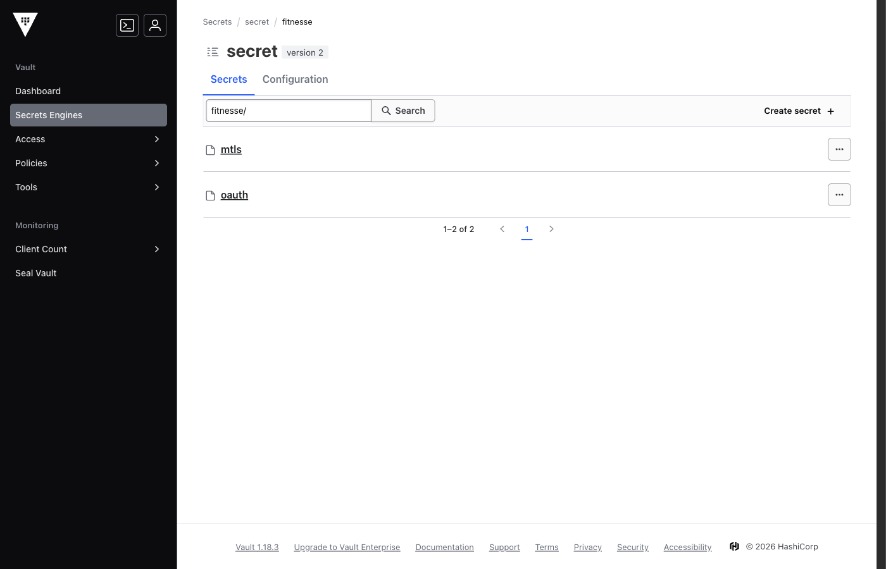
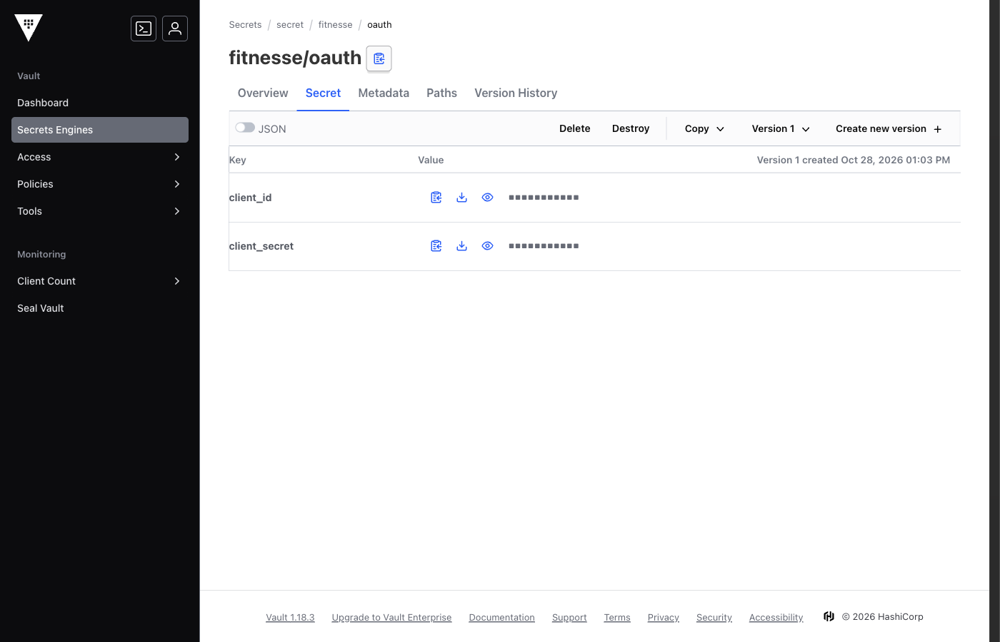
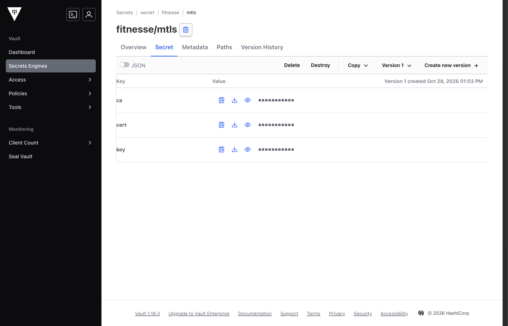
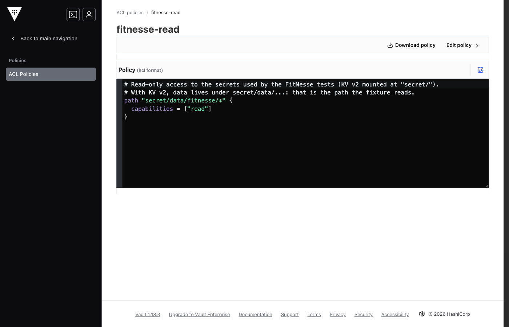
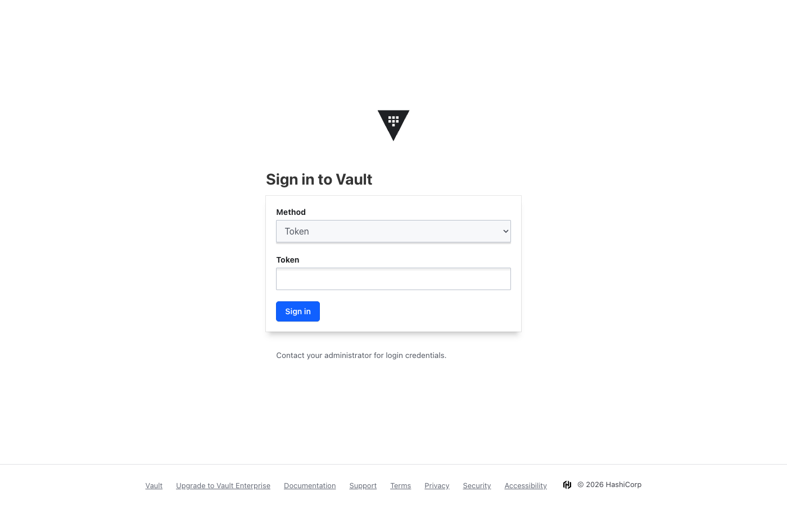
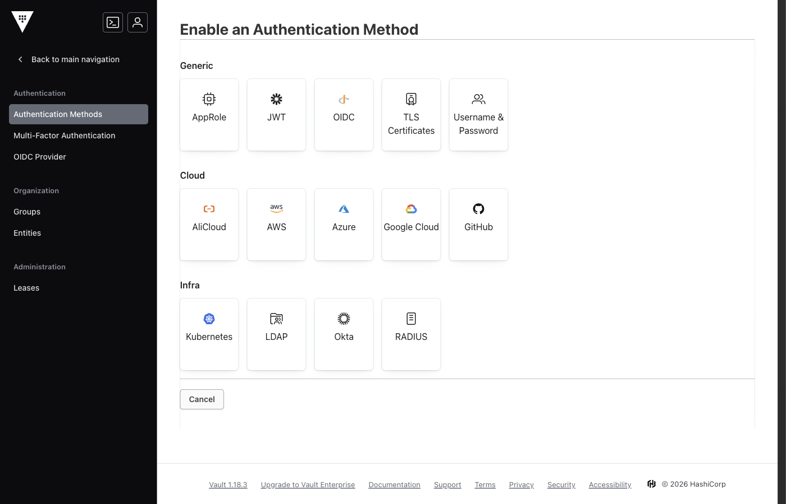
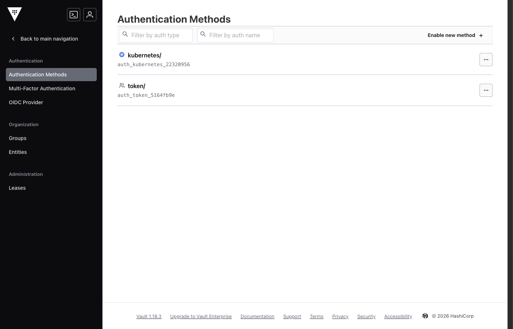
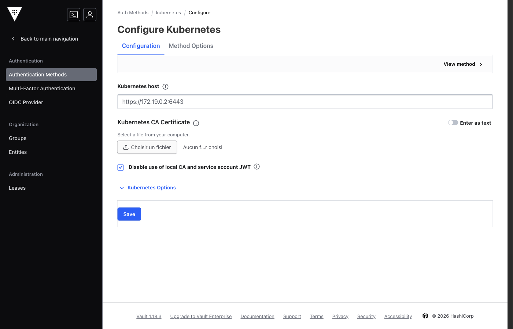
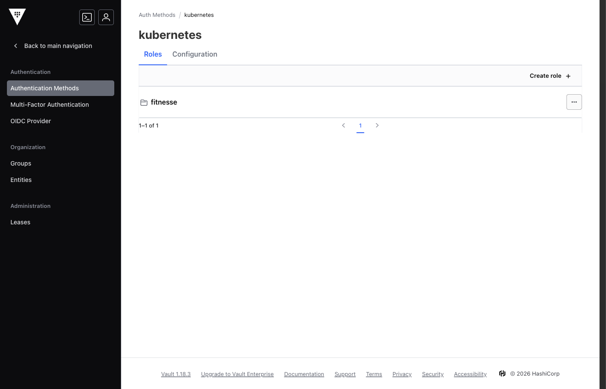
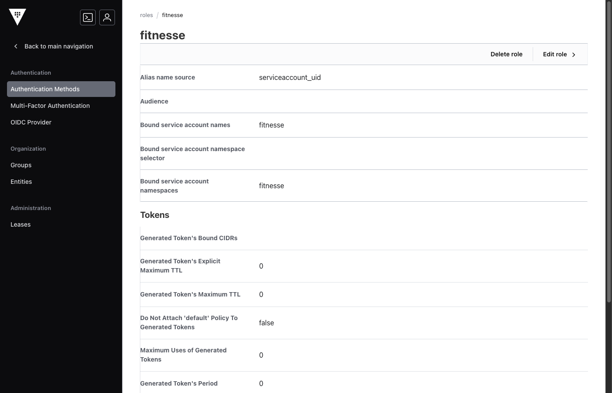

# Preparing HashiCorp Vault for the `HVault` fixture

This guide covers what to set up in Vault (and in Kubernetes) for the fixture to work, with example
secrets and certificates. Every command and screenshot was produced on Vault 1.18.3 and k3s 1.30, and the
fixture was checked in both modes against this setup.

To try it with nothing but Docker installed, see [Local demo](#local-demo) at the end of this page.

## Contents

1. [How the fixture authenticates](#1-how-the-fixture-authenticates)
2. [Common prerequisites: KV v2 engine, secrets, policy](#2-common-prerequisites-kv-v2-engine-secrets-policy)
3. [Token mode (`VAULT_TOKEN`)](#3-token-mode-vault_token)
4. [Kubernetes mode (`VAULT_ROLE`)](#4-kubernetes-mode-vault_role)
5. [Example wiki page](#5-example-wiki-page)
6. [Troubleshooting](#6-troubleshooting)
7. [Local demo](#local-demo)

## 1. How the fixture authenticates

On its first call, the fixture picks its mode:

| Condition | Mode | Typical use |
|---|---|---|
| `VAULT_TOKEN` is set (environment variable or `-Dhvault.token`) | **Token**: the token is sent as is | Developer workstation, CI outside Kubernetes |
| Otherwise, `VAULT_ROLE` is set and the `VAULT_K8S_TOKEN_PATH` file is readable | **Kubernetes**: the fixture exchanges the service account JWT for a Vault token | FitNesse pod on Kubernetes / ROKS |
| Neither | Error `No Vault auth available: ...` | — |

`VAULT_ADDR` is required in both modes. The full list of settings is in the
[README](../README.md#configuration).

## 2. Common prerequisites: KV v2 engine, secrets, policy

### 2.1 KV version 2 secrets engine

The fixture reads the **KV v2** engine only. It uses the `secret/` mount by default; set
`VAULT_KV_MOUNT` for another mount.

```bash
# Only if the mount does not exist yet (dev mode creates it)
vault secrets enable -path=secret -version=2 kv
```

In the wiki page, the path is **relative to the mount** and **without** the `data/` segment:
`fitnesse/oauth` in the wiki maps to the API call `GET /v1/secret/data/fitnesse/oauth`.

### 2.2 Example secrets

**OAuth2 credentials**: one secret with two keys.

```bash
vault kv put secret/fitnesse/oauth \
    client_id=fitnesse-client \
    client_secret=change-me-0123456789
```

**mTLS client certificate**: one secret with three PEM keys. The fixture loads them in one go
(`read all secrets from`) and the REST fixture builds the TLS context with
`MtlsContexts.fromRegistry("mtls.cert", "mtls.key", "mtls.ca")`.

| Key | Content | Accepted formats |
|---|---|---|
| `cert` | Client certificate, optionally followed by its chain | `-----BEGIN CERTIFICATE-----` (one or more) |
| `key` | Private key of the certificate, **not encrypted** | `BEGIN PRIVATE KEY` (PKCS#8, RSA or EC) or `BEGIN RSA PRIVATE KEY` (PKCS#1) |
| `ca` | Authority that signed the certificate of the server to call | `-----BEGIN CERTIFICATE-----` (one or more) |

A complete example, with a demo CA generated by `openssl`:

```bash
# Demo CA
openssl req -x509 -newkey rsa:2048 -nodes -days 365 -subj "/CN=Demo CA" \
    -keyout ca.key -out ca.pem
# Client certificate signed by that CA (unencrypted PKCS#8 key)
openssl req -newkey rsa:2048 -nodes -subj "/CN=fitnesse-client" \
    -keyout client.key -out client.csr
openssl x509 -req -in client.csr -CA ca.pem -CAkey ca.key -CAcreateserial -days 365 -out client.pem

# "@" makes the Vault CLI read the file content
vault kv put secret/fitnesse/mtls cert=@client.pem key=@client.key ca=@ca.pem
```

> Unsupported keys: an EC key in `BEGIN EC PRIVATE KEY` format, or an encrypted key
> (`BEGIN ENCRYPTED PRIVATE KEY`). Convert them to unencrypted PKCS#8 before storing them:
> `openssl pkcs8 -topk8 -nocrypt -in my-key.key -out my-key-pkcs8.key`

The secrets then show up in the UI under **Secrets Engines → secret → fitnesse**:







### 2.3 Read policy

The fixture only needs the `read` capability on the `data/` paths of the secrets it reads.
File [`vault-setup/fitnesse-read.hcl`](vault-setup/fitnesse-read.hcl):

```hcl
path "secret/data/fitnesse/*" {
  capabilities = ["read"]
}
```

```bash
vault policy write fitnesse-read docs/vault-setup/fitnesse-read.hcl
```

In the UI: **Policies → ACL Policies → fitnesse-read**.



> With KV v2, the policy must target `secret/data/...`, not `secret/...`. A policy on `secret/fitnesse/*`
> makes the fixture fail with `Access denied ... (HTTP 403)`.

## 3. Token mode (`VAULT_TOKEN`)

### 3.1 Create a dedicated token

Use a token limited to the `fitnesse-read` policy, never the root token. A **periodic** token renews
itself as long as it is used at least once per period:

```bash
vault token create -policy=fitnesse-read -period=24h -display-name=fitnesse-ci -field=token
```

Tokens are created with the CLI or the API; the UI is mostly useful to check what a token can see. To do
so, sign out and sign in again with the **Token** method and the new token: only the secrets allowed by
the policy are readable.



### 3.2 Configure the fixture

```bash
export VAULT_ADDR=https://vault.example.com:8200
export VAULT_TOKEN=hvs.xxxxxxxx                     # the token created above
export VAULT_CACERT=/etc/ssl/vault-ca.pem           # if the JVM does not trust Vault's certificate
```

- The token can also be passed as a system property (`-Dhvault.token=...`), but **never** in
  `hvault.properties`: it would be ignored there (with a WARN), because that file often ends up in a Git
  repository.
- In token mode, the fixture cannot log in again: if the token expires or is revoked, reads fail with
  `Access denied ... check policy for the provided token`.

## 4. Kubernetes mode (`VAULT_ROLE`)

### 4.1 How it works

1. The FitNesse pod runs under a Kubernetes service account; its JWT is mounted at
   `/var/run/secrets/kubernetes.io/serviceaccount/token`.
2. The fixture sends that JWT and the role name to `POST /v1/auth/kubernetes/login`.
3. Vault checks the JWT with the Kubernetes API (TokenReview), checks that the service account is bound to
   the role, then returns a Vault token carrying the role's policies.
4. The fixture caches that token, requests a new one 30 s before it expires, and logs in again once if
   Vault answers 403.

### 4.2 Kubernetes side

The service account of the FitNesse pod ([`vault-setup/k8s-fitnesse.yaml`](vault-setup/k8s-fitnesse.yaml)):

```yaml
apiVersion: v1
kind: Namespace
metadata:
  name: fitnesse
---
apiVersion: v1
kind: ServiceAccount
metadata:
  name: fitnesse
  namespace: fitnesse
```

**Only if Vault runs outside the cluster**: Vault needs an account allowed to call the TokenReview API
([`vault-setup/k8s-vault-reviewer.yaml`](vault-setup/k8s-vault-reviewer.yaml), `system:auth-delegator`
role). If Vault runs in the same cluster, it uses its own service account and this step is not needed.

```bash
kubectl apply -f docs/vault-setup/k8s-fitnesse.yaml
kubectl apply -f docs/vault-setup/k8s-vault-reviewer.yaml        # Vault outside the cluster only
```

### 4.3 Vault side: enable the Kubernetes method

```bash
vault auth enable kubernetes
```

In the UI: **Access → Authentication Methods → Enable new method → Kubernetes**.





### 4.4 Vault side: configure access to the cluster

**Vault inside the cluster** (the simplest case):

```bash
vault write auth/kubernetes/config kubernetes_host=https://kubernetes.default.svc:443
```

**Vault outside the cluster**: it needs the API server URL, its certificate authority and a token of the
`vault-reviewer` account:

```bash
kubectl apply -f - <<'YAML'
apiVersion: v1
kind: Secret
metadata:
  name: vault-reviewer-token
  namespace: kube-system
  annotations:
    kubernetes.io/service-account.name: vault-reviewer
type: kubernetes.io/service-account-token
YAML
REVIEWER_JWT=$(kubectl get secret vault-reviewer-token -n kube-system -o jsonpath='{.data.token}' | base64 -d)
kubectl config view --raw --minify -o jsonpath='{.clusters[0].cluster.certificate-authority-data}' \
    | base64 -d > k8s-ca.crt

vault write auth/kubernetes/config \
    kubernetes_host=https://api.my-cluster.example.com:6443 \
    kubernetes_ca_cert=@k8s-ca.crt \
    token_reviewer_jwt="$REVIEWER_JWT" \
    disable_local_ca_jwt=true
```

> This reviewer token does not expire: it is only valid for the TokenReview API (`system:auth-delegator`),
> but treat it as a credential. To rotate it, delete and recreate the Secret, then rewrite
> `auth/kubernetes/config`. A token from `kubectl create token vault-reviewer --duration=...` also works,
> but Vault then stops validating logins when it expires.

In the UI: **kubernetes → Configuration → Configure**.



### 4.5 Vault side: create the role

The role binds the `fitnesse` service account of the `fitnesse` namespace to the `fitnesse-read` policy:

```bash
vault write auth/kubernetes/role/fitnesse \
    bound_service_account_names=fitnesse \
    bound_service_account_namespaces=fitnesse \
    token_policies=fitnesse-read \
    token_ttl=1h
```





Check it from a machine that can get a JWT of the service account:

```bash
vault write auth/kubernetes/login role=fitnesse jwt="$(kubectl create token fitnesse -n fitnesse)"
# the response must list the "default" and "fitnesse-read" policies
```

### 4.6 Configure the FitNesse pod

```yaml
apiVersion: apps/v1
kind: Deployment
metadata:
  name: fitnesse
  namespace: fitnesse
spec:
  replicas: 1
  selector:
    matchLabels: { app: fitnesse }
  template:
    metadata:
      labels: { app: fitnesse }
    spec:
      serviceAccountName: fitnesse          # the account bound to the Vault role
      containers:
        - name: fitnesse
          image: registry.example.com/fitnesse:latest
          env:
            - name: VAULT_ADDR
              value: https://vault.example.com:8200
            - name: VAULT_ROLE
              value: fitnesse
            # VAULT_TOKEN must NOT be set, otherwise token mode is chosen
            # - name: VAULT_K8S_AUTH_PATH   # if the method is not mounted at "kubernetes/"
            #   value: k8s-roks
```

Kubernetes mounts and rotates the JWT; the fixture reads it again at each login.

## 5. Example wiki page

With the secrets above:

```
|import|
|io.github.tortaje.hvault|

|script|HVault|
|read secret|fitnesse/oauth|key|client_id|into|clientId|
|read secret|fitnesse/oauth|key|client_secret|into|clientSecret|
|read all secrets from|fitnesse/mtls|with prefix|mtls.|
```

Expected FitNesse report:

| Row | Displayed result |
|---|---|
| `read secret ... into clientId` | `******** [STORED SAFELY IN clientId]` |
| `read secret ... into clientSecret` | `******** [STORED SAFELY IN clientSecret]` |
| `read all secrets from fitnesse/mtls ...` | `******** [3 SECRETS STORED WITH PREFIX mtls.]` |

The values are in the registry (`clientId`, `clientSecret`, `mtls.cert`, `mtls.key`, `mtls.ca`) for the
REST fixture. At the end of the suite, `|clear secrets|` in a `SuiteTearDown` empties the registry.

## 6. Troubleshooting

| Fixture message | Likely cause |
|---|---|
| `Vault not configured: VAULT_ADDR missing ...` | `VAULT_ADDR` is missing from the environment, the system properties and `hvault.properties` |
| `No Vault auth available: set VAULT_TOKEN, or VAULT_ROLE ...` | Neither token nor role; or `VAULT_ROLE` is set but the JWT file is missing (pod without a service account, wrong `VAULT_K8S_TOKEN_PATH`) |
| `Kubernetes login rejected for role 'fitnesse' (HTTP 403)` | Service account or namespace not bound to the role; expired JWT; invalid reviewer token or CA in `auth/kubernetes/config` |
| `Kubernetes login rejected for role 'fitnesse' (HTTP 400)` | The role does not exist (typo in `VAULT_ROLE`) |
| `Access denied to secret/... (HTTP 403): check policy for ...` | The policy does not cover `secret/data/<path>` (missing `data/`), or an expired token in token mode |
| `Secret not found: secret/...` | The path does not exist, or the wiki path includes `data/` |
| `Key 'x' not found in secret/... (available keys: ...)` | Wrong key name; the existing keys are listed |
| `TLS error to Vault: check VAULT_CACERT` | The JVM does not trust Vault's certificate: set `VAULT_CACERT` |
| `Vault unreachable after 3 attempts: ...` | Vault unreachable, sealed (HTTP 503) or overloaded (HTTP 429) |
| `Unsupported key format in 'mtls.key'` | EC key in SEC1 format or encrypted key: convert it to unencrypted PKCS#8 (see 2.2) |

## Local demo

The [`vault-setup/demo-local.sh`](vault-setup/demo-local.sh) script uses Docker to start a dev-mode Vault
and a k3s cluster locally, then applies **exactly** the setup of this guide (example secrets, policy,
token, Kubernetes method and role). The screenshots on this page come from that demo.

```bash
docs/vault-setup/demo-local.sh up      # ~1 min; prints the variables to export for each mode
docs/vault-setup/demo-local.sh down    # removes everything
```

- UI: http://127.0.0.1:8200/ui, **Token** method, token `root` (dev mode only).
- The service account JWT provided by the demo is valid for 1 hour; run `down` then `up` again to get a
  new one.
- Never reuse this setup as is in production: dev mode keeps everything in memory, without TLS, with a
  well-known root token.
