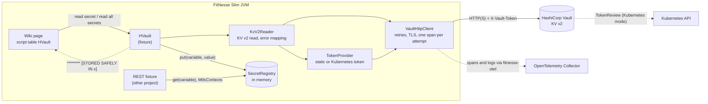
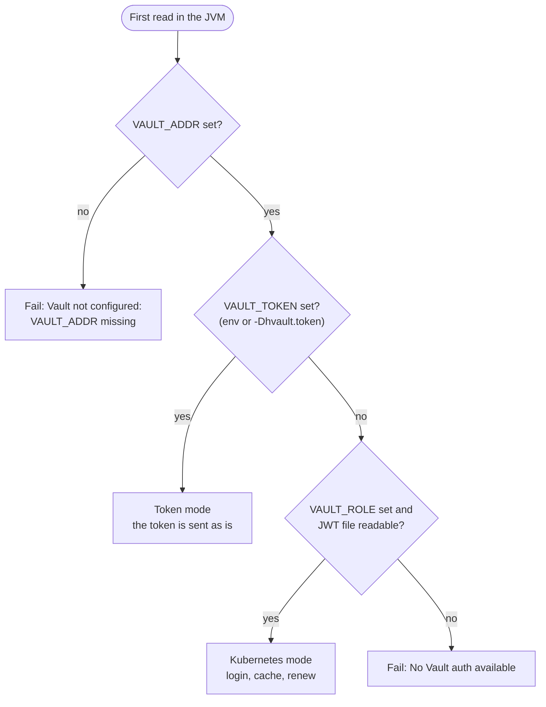
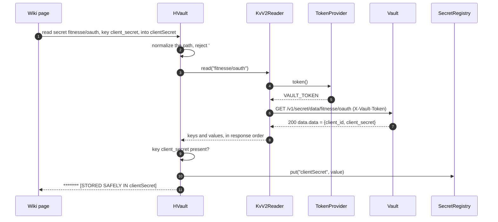
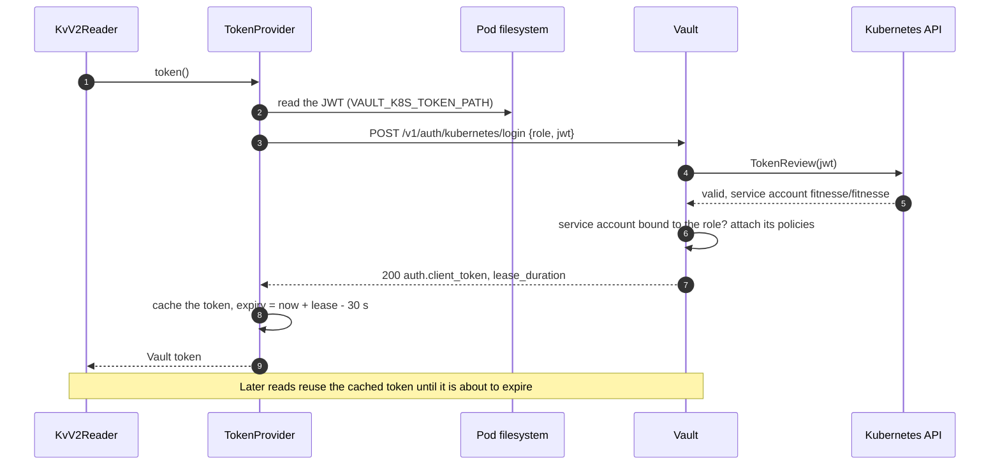
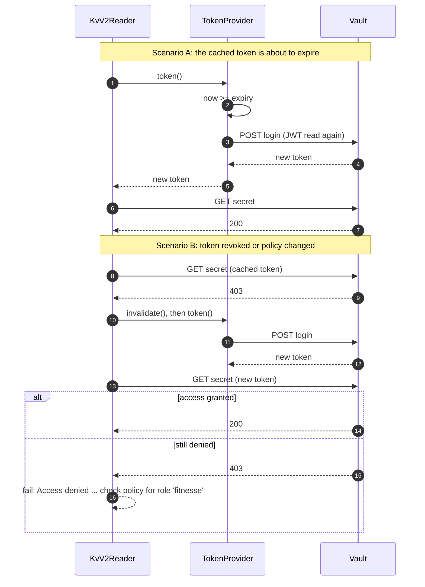
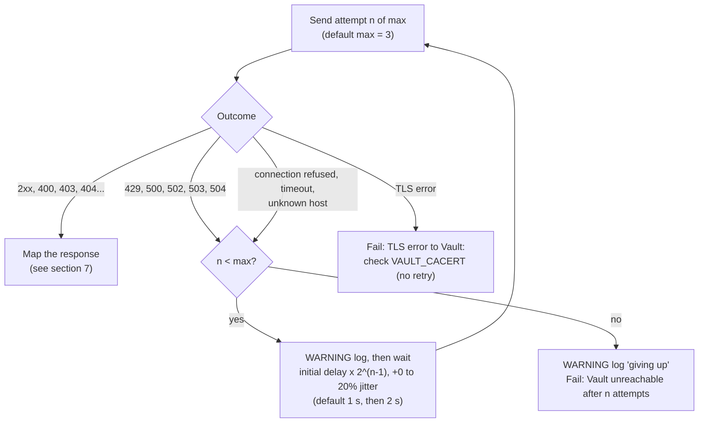
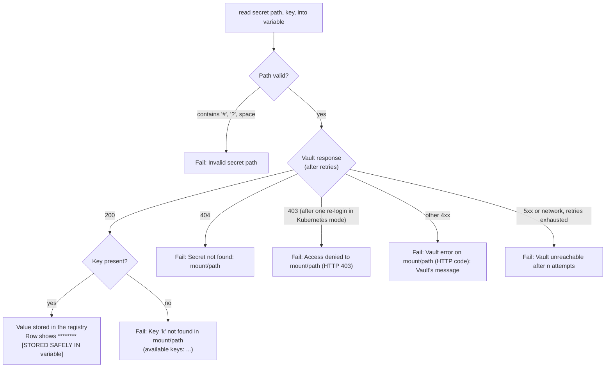

# How the `HVault` fixture works

Diagrams of the fixture's internals, its exchanges with Vault and Kubernetes, and what happens in each
scenario. Setup steps are in the [Vault setup guide](guide-vault.md); settings are in the
[README](../README.md#configuration).

## Contents

1. [Components](#1-components)
2. [Choosing the authentication mode](#2-choosing-the-authentication-mode)
3. [Reading a secret with a static token](#3-reading-a-secret-with-a-static-token)
4. [Kubernetes login](#4-kubernetes-login)
5. [Token renewal and re-login on 403](#5-token-renewal-and-re-login-on-403)
6. [Retries](#6-retries)
7. [Outcome of a wiki row](#7-outcome-of-a-wiki-row)

## 1. Components

The fixture runs in FitNesse's Slim JVM. Secret values only travel from Vault to the in-memory
registry; the wiki page only gets a masked confirmation.

## 2. Choosing the authentication mode

The mode is decided once, on the first call that needs a token, and kept for the JVM lifetime.

## 3. Reading a secret with a static token

`|read secret|fitnesse/oauth|key|client_secret|into|clientSecret|`

`|read all secrets from|fitnesse/mtls|with prefix|mtls.|` follows the same path, then stores every key
(`mtls.cert`, `mtls.key`, `mtls.ca`) only once the whole response has been read: all or nothing.

## 4. Kubernetes login

The pod's service account JWT is exchanged for a Vault token; Vault checks it with the Kubernetes API.

A rejected login (HTTP 400 or 403) fails the row with `Kubernetes login rejected for role '...'`.

## 5. Token renewal and re-login on 403

In Kubernetes mode the fixture keeps its token valid on its own. In token mode there is no way to get a
new token, so a 403 fails the row straight away.

At most one re-login per read: a second 403 means the policy really does not allow the path.

## 6. Retries

Every HTTP call (reads and logins) goes through the same loop. Each attempt is its own span; each failed
attempt is logged at WARNING.

## 7. Outcome of a wiki row

What a `read secret` row shows, depending on what Vault answers. A failed row never changes the
registry.

Failures appear as an exception on the row in FitNesse; messages name paths and keys, never values.
